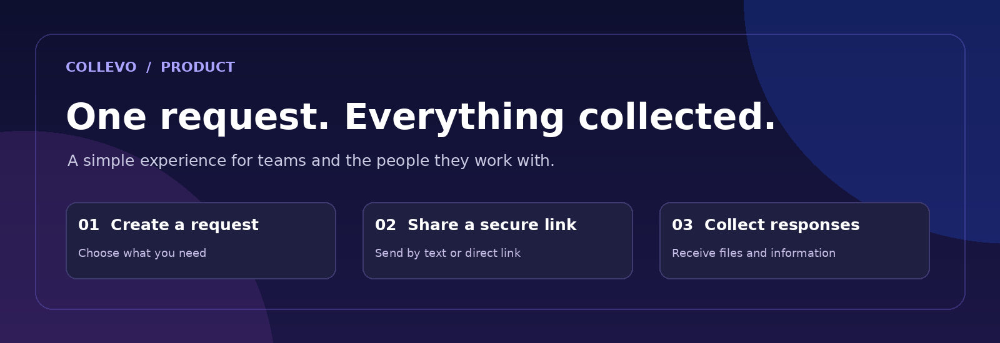
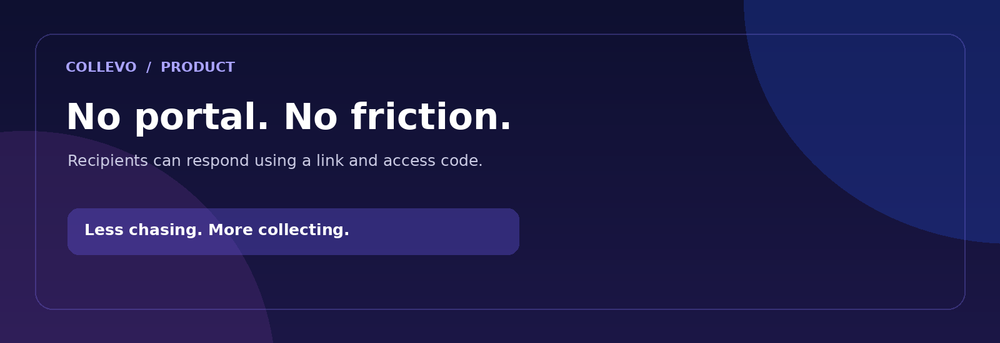

 

### Collect what you need. Skip the follow-ups.

**The simpler way for businesses to request, collect, and organize information from clients.**

[**Website**](https://collevo.io) · [**App**](https://app.collevo.io) · [**How it works**](#how-it-works) · [**Features**](#built-for-the-back-and-forth)

 

`B2B SaaS` &nbsp; · &nbsp; `No client login` &nbsp; · &nbsp; `Information collection`

---

## The back-and-forth ends here.

Getting a document, a photo, or a few details from a client shouldn't take five emails, three texts, and another reminder.

**Collevo** helps businesses request information in one place, share a simple link, and let clients send everything back without creating an account. It's designed to make collection feel effortless for both sides.

<table>
<tr>
<td width="50%" valign="top">

### For your team

- Request documents, photos, and details together.
- Give clients one clear place to respond.
- Reduce repetitive follow-ups and scattered replies.
- Keep the collection process organized.

</td>
<td width="50%" valign="top">

### For your clients

- Open a link sent to them.
- Use an access code instead of creating an account.
- See what's being requested.
- Submit information and files in one flow.

</td>
</tr>
</table>

 

## How it works

**01 — Ask once.** Create a collection request for the information, documents, or images you need.

**02 — Send one link.** Share the request with your client by text or another communication channel.

**03 — Let them respond.** Your client opens the link, enters their code, and supplies what's needed — no client account required.

**04 — Stay organized.** Keep the information you collect connected to the request instead of buried across message threads.

> **One request. One link. Less chasing.**

## Built for the back-and-forth

| Capability | What it means |
| :--- | :--- |
| **Unified requests** | Ask for multiple pieces of information in a single place. |
| **Document collection** | Request supporting documents from clients. |
| **Photo uploads** | Gather images without digging through texts and email threads. |
| **Information gathering** | Collect the details your team needs to move forward. |
| **Link-based access** | Give recipients a straightforward path to their request. |
| **Code-based entry** | No client login or account creation required. |
| **Text-first sharing** | Make requests easy to deliver where clients already communicate. |

 

## Made for teams that need answers

From onboarding and document intake to gathering job-site photos or collecting missing details, Collevo is built around a familiar problem: **you can't move forward until someone sends you something.**

Rather than introducing another complicated client portal, Collevo keeps the recipient experience lightweight and the request process centralized.

## The Collevo philosophy

**Simple for the sender. Simpler for the recipient.**

We believe requesting information should be clear, fast, and human. Businesses should spend less time tracking people down, and clients shouldn't need another password just to upload a file.

## Brand assets

This repository includes locally stored brand artwork used in this README.

| Asset | File |
| :--- | :--- |
| Pixel-wave header | [`assets/pixel-wave-banner.png`](assets/pixel-wave-banner.png) |
| Full pixel wordmark | [`assets/pixel-wordmark.png`](assets/pixel-wordmark.png) |
| Pixel icon | [`assets/pixel-icon.png`](assets/pixel-icon.png) |
| Gradient wordmark | [`assets/wordmark.png`](assets/wordmark.png) |
| Gradient icon | [`assets/icon.png`](assets/icon.png) |
| Social icon | [`assets/social-icon.jpg`](assets/social-icon.jpg) |
| Workflow illustration | [`assets/workflow.png`](assets/workflow.png) |
| Product principle graphic | [`assets/product-principle.png`](assets/product-principle.png) |

> Brand artwork is provided for Collevo's own use. Its inclusion here does not grant third parties permission to reuse the Collevo name or identity.

---

  

**Less follow-up. More forward.**

[Explore Collevo](https://collevo.io) · [Open the app](https://app.collevo.io)

© Collevo. All rights reserved.

